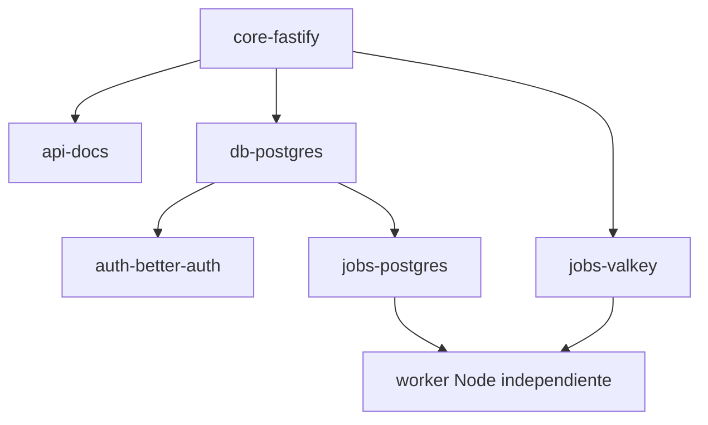

# Receta LEGO: OpenAPI + PostgreSQL + Better Auth + Jobs

**Fecha:** 2026-10-13
**Estado:** DISEÑO — pendiente de validación de composición y pruebas; **NO IMPLEMENTAR** código ni instalar servicios hasta completar los gates.
**Rama:** `feat/fastify-lego-foundation`.
**Fuentes previas:** `fastify-lego-foundation.md`, `fastify-lego-foundation-audit-2026-10-13.md`, `adr-distribution-pnpm-shadcn-marketplace.md`.

## 1. Objetivo

Agregar **cuatro capacidades elegidas** a un proyecto **Fastify 5 + TypeScript + Node 24 LTS** sin escribir nuevos subsistemas de infraestructura: OpenAPI, PostgreSQL, autenticación y ejecución de trabajos en segundo plano. Los add-ons son opcionales en Kit Fundador; en **esta receta** se instalan juntos como una variante específica. El core continúa funcionando sin ellos.

**Producto esperado:** un repositorio generado e independiente, con API HTTP, una base PostgreSQL, sesiones seguras y un proceso worker independiente; ningún framework de plugins ni marketplace propios en runtime.

## 2. Selección técnica y requisitos

| ID | Tipo | Paquetes/productos propuestos | Requiere | Efectos al activar |
|---|---|---|---|---|
| `core-fastify` | Núcleo | `fastify@5`, Node 24 LTS, validación JSON Schema, logging Pino | Nada externo | HTTP + config + `/health` |
| `api-docs` | Plugin | `@fastify/swagger@9`, `@fastify/swagger-ui@5` | Core | Esquema OpenAPI + UI protegida/off en prod |
| `db-postgres` | Plugin + servicio externo | `drizzle-orm`, `drizzle-kit`, `pg`; PostgreSQL 16+ **a validar** | Core, `DATABASE_URL` | Pool y migraciones de aplicación |
| `auth-better-auth` | Plugin | `better-auth`, `@better-auth/drizzle-adapter`, `@fastify/cors` solo cuando hay frontend cross-origin | `db-postgres`, `BETTER_AUTH_SECRET`, URL y trusted origins | Sesiones + rutas `/api/auth/*` |
| `jobs-postgres` | Producer plugin + worker | `bullmq@6` con `createPostgresBackend`, `pg` | `db-postgres` | Jobs en schema `bullmq`; migración separada |
| `jobs-valkey` | Producer plugin + worker + servicio externo | `bullmq@6` + cliente Redis/Valkey validado; Valkey | Core, `QUEUE_URL` | Colas y worker sobre Valkey |

**Versiones:** los majors de Fastify/OpenAPI y BullMQ 6 son candidatos documentados, no un lockfile comprobado. No fijar versiones exactas o `latest` para usuarios hasta ejecutar instalación y pruebas de compatibilidad. Verificar Drizzle/adapter en sus versiones reales (la documentación de Drizzle contiene ejemplos `@rc`).

### Grafo de dependencias



Reglas de exclusividad: **elegir exactamente uno de** `jobs-postgres` **o** `jobs-valkey`; ambos exponen el mismo contrato de productor/worker, pero **nunca coexisten en el mismo proyecto**. `auth-better-auth` no puede activarse sin `db-postgres` en esta receta. `api-docs` funciona por separado.

### Validación estática realizada

- `core + api-docs + db-postgres + auth-better-auth + jobs-postgres` => DAG completo, sin dependencias faltantes ni conflictos declarados.
- `core + api-docs + db-postgres + auth-better-auth + jobs-valkey` => DAG completo, sin dependencias faltantes ni conflictos declarados.
- `auth-better-auth` por sí solo resuelve `db-postgres` y `core`.
- Solicitar ambos jobs produce conflicto explícito.
- Solicitar un id desconocido se rechaza.
- **Esta comprobación valida solo el grafo lógico. NO valida npm/pnpm, semver, Fastify plugin scopes, PostgreSQL, cookies, jobs ni registry shadcn.**

## 3. Variantes de infraestructura

### Variante A — menor infraestructura (candidata para PoC)

```text
                  [Fastify API] ---- [worker proceso Node]
                        |                |
                        +----- PostgreSQL +
                     (app/auth/bullmq schemas)
```

- Drizzle gestiona tablas del proyecto y el esquema generado de Better Auth; BullMQ gestiona su **propio esquema** PostgreSQL mediante `runMigrations`, ejecutado como etapa controlada de despliegue, no automáticamente al iniciar cada proceso.
- BullMQ 6 PostgreSQL requiere PostgreSQL >=13; elegir 16+ como hipótesis de referencia, validar compatibilidad real y sin degradar los requisitos.
- Cada instancia de BullMQ utiliza conexiones/pool y `LISTEN` dedicados. Dimensionar conexiones para API, auth y workers; asignar schemas y usuarios mínimos.
- PostgreSQL BullMQ no admite downgrades de esquema; exigir respaldo/restauración probados y plan de rollback **sin revertir automáticamente el schema**.
- El backend PostgreSQL es menos battle-tested que Redis según BullMQ. **Esta variante no queda aprobada para producción sin PoC y prueba de carga/fallos.**

### Variante B — baseline operativa conservadora

```text
                  [Fastify API] ---- [worker proceso Node]
                      |     \            |
                 PostgreSQL  +--------- Valkey
              (app/auth)            (jobs)
```

- Drizzle y Better Auth usan PostgreSQL; BullMQ usa Redis/Valkey mediante cliente compatible (ioredis o adapter Valkey Glide según matriz probada).
- Agrega una dependencia externa pero utiliza la modalidad de cola más madura y separa carga de jobs de la base relacional.
- Exige Valkey persistente y política de memoria sin expulsión arbitraria para claves de cola; comprobar integridad tras restart/failover.
- Dos perfiles Compose opcionales `postgres` y `valkey`, o DSN a servicios gestionados; nunca instalar ambos en el core.

**Elección provisional:** probar Variante A primero por simplicidad y Variante B como control de referencia. No seleccionar predeterminado definitivo hasta medir corrección, operaciones, recuperación y rendimiento bajo la misma carga.

## 4. Contratos entre piezas

### Fastify bootstrap y OpenAPI

1. Inicializar configuración, error handlers y seguridad; registrar `@fastify/swagger` **antes** de cualquier ruta que deba documentarse.
2. Registrar adaptadores de infraestructura (pool PG, auth handler y jobs producer), respetando encapsulación y scope; registrar rutas de aplicación después de Swagger.
3. Registrar `@fastify/swagger-ui` solamente si la receta y el entorno habilitan su interfaz. No habilitar docs en producción sin autenticación/autorización explícitas.
4. OpenAPI generado cubre rutas Fastify propias; Better Auth atiende un `catch-all`, que **no se convierte automáticamente en operaciones OpenAPI completas**. No prometer documentación unificada en esta fase.
5. Better Auth tiene un plugin Open API y `auth.api.generateOpenAPISchema()`; su documentación lo considera en etapas tempranas. Tratar la fusión de esquemas como **PoC separada**, no dependencia obligatoria. Mantener temporalmente documentación API y auth separadas.
6. Probar conflictos de routePrefix (`/docs`, `/api/auth/*`), `securitySchemes` y cookies/proxy.

### PostgreSQL/Drizzle

- Pool propiedad del plugin `db-postgres`; se crea al activar la pieza y se cierra en `onClose`. Para worker separado, conexiones propias y finalización en su proceso.
- `drizzle-kit generate/check/migrate` constituye la fuente de migración de **tablas de aplicación + Better Auth**.
- El schema de auth debe generarse mediante CLI Better Auth y convertirse en migraciones Drizzle versionadas; nunca correr dos migradores independientes sobre las mismas tablas.
- Elegir namespaces `app` (opcional), `auth` y `bullmq`; validar `search_path` y privilegios si se comparten pools.
- El backend BullMQ PostgreSQL tiene `runMigrations` **separado** del migrador de Drizzle. Iniciar API/worker solo tras comprobar las dos versiones de esquema.
- No ejecutar `push`/auto-sync en producción; migraciones como proceso explícito y único en CI/deploy.

### Better Auth y autorización

- Integrar con el handler Fastify oficial en `/api/auth/*`, tomando URL pública de configuración confiable, no confiando ciegamente en un header Host enviado por el cliente.
- Revisar reenvío de headers, cookies múltiples (`Set-Cookie`), códigos y cuerpos entre Web Request/Response y Fastify; pruebas de login real son obligatorias.
- Configurar `trustedOrigins`, URL de base, cookies seguras, SameSite, CORS restringido y proxy HTTPS según despliegue; jamás permitir `origin: *` con credenciales.
- Identidad no equivale a autorización: incorporar un guard simple y probado para rutas privadas; ningún endpoint público puede asignar rol `admin`.
- No migrar silenciosamente `User/Email/Password` existentes a Better Auth; aislar como ejemplo y diseñar migración/identidad solo si un proyecto necesita datos heredados.
- Los endpoints de auth no se vuelven globalmente públicos por activar la UI de OpenAPI. Documentar rutas internas sin exponer secretos ni permitir ejecución anónima insegura.

### Jobs y worker

- Producer es un plugin del proceso API con interfaz de dominio mínima (`enqueue(jobType, payload, opts)`) y retorno `jobId`/estado. **El worker corre en otro proceso**, iniciado explícitamente.
- Tipos/versiones de payload, política de reintentos/backoff, deduplicación/idempotencia, retención y estados documentados. No poner secretos, sesiones/cookies o información sensible en payload de prueba.
- El worker **no hereda** la sesión HTTP ni debe confiar en `actorId` no validado del payload. Proteger la publicación de trabajos y verificar permiso de acceso a estado/resultados por usuario o tenant.
- API no debe exponer un endpoint genérico público de encolado; las rutas se agregan por cada proyecto o únicamente en fixtures de test.
- Cerrar productor/worker y conexiones con timeout; probar parada durante tarea, proceso muerto y reanudación.
- Una transacción de aplicación PostgreSQL seguida de `queue.add` **no es automáticamente atómica**, incluso en variante PostgreSQL. Para workflows con cambios DB + encolado críticos, exigir outbox transaccional o compensación con pruebas; fuera del contrato mínimo de esta receta.
- Valkey y PostgreSQL usan el mismo contrato abstracto del productor: el backend se decide en build/config, nunca se cambia en caliente ni se mezclan trabajos de dos backends sin migración formal.

## 5. Receta de distribución (propuesta, no publicada)

- `shadcn` **Universal Registry Items** desde GitHub para copiar archivos TypeScript, esquema, tests y .env.example con `target` explícito; `registryDependencies` permite expresar dependencias entre items.
- Los paquetes npm se resuelven con pnpm y un `pnpm-lock.yaml` reproducible. No generar también `package-lock.json` para un nuevo proyecto pnpm sin caso de uso probado.
- Un item **no garantiza** modificar adecuadamente el entrypoint de Fastify. Evaluar: (A) `@fastify/autoload` con fases/orden comprobados, o (B) composición explícita de imports mantenida por el generador en tiempo de construcción. No escribir gestor runtime propio.
- `api-docs` y `auth` necesitan control de orden; su registro no puede depender de orden alfabético accidental de archivos.
- Items de jobs `jobs-postgres` y `jobs-valkey` son alternativos. shadcn no ofrece necesariamente una regla nativa de `conflicts`: comprobar con validación previa/documentación y rechazar combinación inválida antes de escribir archivos.
- Registry pinneado por tag/SHA; observar `--dry-run` y `--diff`; no sobrescribir código consumidor ni ejecutar scripts arbitrarios de terceros.
- El SDK de shadcn y un generador mínimo solo se consideran si la prueba de integración del registry existente falla.

### Árbol conceptual del resultado (no existe todavía)

```text
src/
  app.ts
  server.ts
  config/env.ts
  plugins/api-docs.ts
  db/client.ts
  db/schema.ts
  auth/auth.ts
  auth/fastify-handler.ts
  jobs/contracts.ts
  jobs/producer.ts
  workers/jobs.ts                  # ejecución separada de la API
drizzle.config.ts
drizzle/                           # migraciones aplicación + auth
tests/
  integration/
  security/
  composition/
.env.example
pnpm-lock.yaml
compose.yaml                        # receta optativa, no core
```

## 6. Matriz de riesgos/conflictos

| ID | Tipo | Riesgo | Mitigación / prueba exigida |
|---|---|---|---|
| C01 | Bloqueante | Swagger registrado después de rutas | Orden de instalación y assert de cobertura de paths Fastify |
| C02 | Alto | Catch-all Better Auth ausente de spec | Declarar docs separadas; probar esquema auth por plugin propio antes de merge |
| C03 | Bloqueante | Better Auth sin DB o schema obsoleto | Dependencia `auth -> db`, generación y migración versionadas; fallo controlado |
| C04 | Bloqueante | Doble migrador modifica tablas de auth | Único owner Drizzle para tablas app/auth, migrador BullMQ solo su schema |
| C05 | Bloqueante | `jobs-postgres` y `jobs-valkey` juntos | Rechazar antes de generar archivos o instalar paquetes |
| C06 | Alto | Valkey/Redis no responde | Timeout, backoff, test worker restart, límites para peticiones HTTP |
| C07 | Alto | PostgreSQL backend BullMQ v6 no maduro para carga objetivo | Comparación con Valkey, migración/rollback, límites de conexiones y pruebas de fallos |
| C08 | Crítico | Autorregistro `admin` o acceso a jobs de otros usuarios | Tests 401/403 y tenant ownership; no roles desde cliente |
| C09 | Alto | Headers/cookies de Better Auth mal reenviados | Login/logout/refresh, multi Set-Cookie, CSRF/origin, HTTPS proxy |
| C10 | Alto | Error/duplicación por caída entre transacción y enqueue | No prometer atomicidad; exigir outbox para el caso crítico |
| C11 | Alto | Registry sobrescribe composición/app.ts y rompe builds | Instalación dos órdenes, diffs, idempotencia, rollback de archivos |
| C12 | Alto | Schemas/credenciales compartidas indebidamente | Separar namespaces, usuarios DB, no loguear DSN ni tokens |
| C13 | Alto | Librerías incompatibles o release candidates | Fijar versiones reales y paridad de tests; resolver typecheck antes de aceptar |
| C14 | Medio | Carga de BullMQ afecta latencia del PostgreSQL de auth | Presupuesto de conexiones y latencia; stress aislado/simulaciones |

## 7. Plan de pruebas antes de implementar la receta en el kit

### Gate 0 — Metadatos/composición (estático)
- [x] Grafos A y B sin ciclos y con cierre de dependencias completo para las cuatro capacidades.
- [x] Solicitar ambos backends de jobs se rechaza; ids desconocidos se rechazan.
- [ ] Obtener matriz exacta de versiones compatibles, licencias, engine Node y peerDeps; generar SBOM/lockfile del prototipo aislado.
- [ ] Validar esquema universal shadcn y resolución de items en repositorio de prueba, sin modificar `main` ni consumidores.

### Gate 1 — Bootstrap/registry
- [ ] Generar core limpio con pnpm, añadir docs+pg+auth+jobs; `pnpm install --frozen-lockfile`, lint, types, tests, build, ejecutar JS compilado.
- [ ] Instalar en orden inverso y repetir la instalación: no duplicados, no colisiones, contenido equivalente.
- [ ] `--dry-run` no crea archivos; diff detecta modificaciones en fichero consumidor; rollback no borra modificaciones previas.
- [ ] Falla de red/npm/registry, nombre inválido, versión incompatible o dependencia ausente generan error explícito sin corromper el proyecto.

### Gate 2 — HTTP/OpenAPI
- [ ] `/health` 200; error 400/404/413/500; OpenAPI válido y documenta rutas Fastify propias.
- [ ] Con docs OFF, ni UI ni JSON de spec quedan expuestos; con docs ON, rutas esperadas y esquema correctos.
- [ ] Documento sobre Better Auth separado por defecto; validar como PoC generación/fusión si se pide un catálogo unificado.

### Gate 3 — DB/auth
- [ ] PostgreSQL limpio, Drizzle migraciones + Better Auth schema: generación, up, re-ejecución e integridad.
- [ ] Registro, login, sesión, logout, cookie secure/samesite, CORS/trusted origins y proxy HTTPS realista.
- [ ] 401 anónimo, 403 privilegios insuficientes, intento de hacerse admin desde signup rechazado, SQL injection y manejo de errores sanitizados.
- [ ] `DATABASE_URL` ausente o inválida detiene el servicio habilitado con mensaje útil; `/health` y `/ready` distinguen liveness de dependencia.

### Gate 4 — Jobs PostgreSQL (A) vs Jobs Valkey (B)
- [ ] Producer→worker: enqueue, ack, resultado, retry, backoff, deduplicación, fallo permanente, payload inválido.
- [ ] Reiniciar worker, kill -9, caída de backend, tiempo de espera y graceful SIGTERM: ninguna tarea se pierde silenciosamente ni se ejecuta con efectos duplicados.
- [ ] Migración de esquema BullMQ Postgres ejecutada antes de workers, repetible, respaldo/restauración y error de versión de cliente.
- [ ] Variante A: medir conexiones PostgreSQL API+auth+jobs/worker, polling/NOTIFY y p95 de auth bajo carga de jobs.
- [ ] Variante B: persistencia de Valkey, noeviction para jobs, compatibilidad de cliente y comportamiento tras reinicio.
- [ ] Probar recuperación de job cuando hubo éxito del efecto externo pero fallo del ack (idempotencia), y caso transaction→enqueue inconsistente.
- [ ] Documentar régimen aceptable de latencia/throughput/conexiones medido en el mismo hardware; no afirmar benchmark universal.

### Gate 5 — Combinaciones

| Variante | Composición | Gate mínimo |
|---|---|---|
| Base | `core` | install/build/start/health sin servicios externos |
| Docs | `core + api-docs` | /docs válido y desactivable |
| DB | `core + db-postgres` | conexión/migraciones/close |
| Auth | `core + db-postgres + auth` | registro/login/session/401/403 |
| Jobs A | `core + db-postgres + jobs-postgres` | worker separado y migración BullMQ |
| Jobs B | `core + jobs-valkey` | producer/worker con Valkey |
| Full A | `core + docs + db + auth + jobs-postgres` | todos los gates, docs y sesiones |
| Full B | `core + docs + db + auth + jobs-valkey` | todos los gates, docs y sesiones |
| Invalid | `jobs-postgres + jobs-valkey` | rechazo sin cambios |

Testear cada resultado **fuera del repo Kit Fundador** para detectar archivos ocultos, dependencias `workspace:` y rutas ESM defectuosas.

## 8. Decisiones bloqueadas y criterios GO/NO-GO

1. **NO-GO** para publicar cualquier item hasta validar instalación universal shadcn en backend Fastify sin React/Tailwind.
2. **NO-GO** para declarar compatibilidad completa hasta probar auth + docs (fidelidad de contratos y cookie round-trip).
3. **NO-GO** para jobs sobre PostgreSQL en producción hasta medir recuperación de fallos, schema upgrades/no-downgrade y carga real. Variante Valkey como fallback si falla.
4. **NO-GO** para API/jobs con privilegios sin suite anti-escalada y tenant isolation.
5. **NO-GO** si el nuevo proyecto no compila/arranca sin editar código manualmente después de instalar las cuatro piezas.
6. **NO-GO** para composición transaccional DB+jobs sin outbox/compensación probados.

**Estado presente:** sólo está validado el **grafo de dependencias a nivel lógico** y hay respaldo documental oficial de las integraciones principales. Ningún binario, migración, lockfile, registry ni worker de estas recetas se ha implementado o probado en esta rama.

## 9. Fuentes oficiales

- Fastify plugin encapsulation: https://fastify.dev/docs/latest/Reference/Plugins/
- Fastify Swagger register order: https://github.com/fastify/fastify-swagger
- Swagger UI compatibility Fastify5/Swagger9: https://github.com/fastify/fastify-swagger-ui
- Better Auth Fastify integration: https://better-auth.com/docs/integrations/fastify
- Better Auth Drizzle adapter: https://better-auth.com/docs/adapters/drizzle
- Better Auth OpenAPI plugin (early stage): https://better-auth.com/docs/plugins/open-api
- Drizzle PG driver: https://orm.drizzle.team/docs/get-started/postgresql-new
- Drizzle migrations: https://orm.drizzle.team/docs/drizzle-kit-migrate
- BullMQ PostgreSQL backend and limitations: https://docs.bullmq.io/guide/postgresql
- BullMQ Redis/Valkey connections: https://docs.bullmq.io/guide/connections
- BullMQ idempotent jobs: https://docs.bullmq.io/patterns/idempotent-jobs
- shadcn GitHub registry: https://ui.shadcn.com/docs/registry/github
- shadcn universal items: https://ui.shadcn.com/docs/registry/examples

## 10. Continuación de validación de composición (2026-10-13)

**Alcance:** documentación oficial + inspección de manifests/releases GitHub + validador sintético in-memory. **No se ha ejecutado pnpm/npm install, compilado un proyecto generado, conectado una BD ni iniciado un worker.**

### 10.1 Compatibilidad candidata (verificada por manifiestos/metadata, no por npm ci)

| Dependencia | Versión candidata específica | Evidencia | Condición pendiente |
|---|---|---|---|
| Node.js | 24 LTS | objetivo de la fundación | disponer de Node 24 en runner y probar binario compilado |
| fastify | 5.12.7 | release estable publicada el 2026-10-13 | instalar y probar ESM NodeNext |
| @fastify/env | 5.0.3 | `index.js` del tag declara `fastify: '5.x'` | confirmar config async y plugin scopes |
| @fastify/cors | 11.3.1 | `index.js` del tag declara `fastify: '5.x'` | credenciales, trustedOrigins y orígenes permitidos |
| @fastify/helmet | 13.2.0 | `index.js` del tag declara `fastify: '5.x'` | CSP Swagger UI y tests de headers |
| @fastify/swagger | 9.9.2 | `index.js` del tag declara `fastify: '5.x'` | registrarse antes de rutas |
| @fastify/swagger-ui | 5.2.6 | `index.js` del tag declara `fastify: '5.x'`; declara dependencia a swagger | UI deshabilitada por defecto en producción |
| drizzle-orm | 0.45.4 | manifiesto del proyecto; satisfecho por peer `^0.45.2` del adapter | instalación + typecheck junto a Better Auth |
| drizzle-kit | 0.31.11 | manifiesto del proyecto; rango de Better Auth `>=0.31.4` | generar/migrar auth+app, revisar SQL |
| better-auth | 1.7.7 | release/manifiesto del repo | cookies, sesiones, host confiable, CORS y 401/403 |
| @better-auth/drizzle-adapter | 1.7.7 | manifiesto con peer drizzle `^0.45.2 || >=1.0.0-rc.1 <2.0.0` | versionar coordinado con better-auth y comprobar API real |
| bullmq | 6.3.14 | release/manifiesto publicado el 2026-10-13; peer `pg>=8` o `ioredis>=5` | migraciones e idempotencia/recuperación bajo fallos |
| pg | 8.x **sin patch fijado** | peer requerido Drizzle/Better Auth/BullMQ PG | seleccionar versión exacta y confirmar pool/SSL |
| ioredis | 5.x **sin patch fijado** (solo variante B) | peer BullMQ >=5 | fijar versión exacta y validar Valkey |

Nota: los repositorios de Fastify ya contienen nuevas majors en `main` (por ejemplo fastify 6 alpha, swagger-ui 6 y env 7). **No confundir `main` de cada paquete con el conjunto de versiones probado.** Los pines de la tabla son candidatos, no un lockfile validado. Aunque swagger-ui 6 y env 7 declaran metadata para Fastify 5, el baseline conservador sigue v5 en ambos para esta PoC; revisar notas de migración antes de actualizarlos.

### 10.2 Resultado de pruebas estáticas

Se ejecutó un verificador efímero en memoria con cierre transitivo de requisitos, orden de registro, detección de conflictos, destino de archivos, propiedad de esquema y composición de paquetes. **Resultados:**

- Selecciones posibles de cinco add-ons (`api-docs`, `db-postgres`, `auth-better-auth`, `jobs-postgres`, `jobs-valkey`): **32**.
- Combinaciones lógicamente válidas: **24**.
- Combinaciones rechazadas: **8**, todas las que piden los dos backends de trabajos simultáneamente.
- **15 verificaciones focales** adicionalmente: A/B completos, número de servicios, auto-resolución auth→DB, independencia docs, independencia jobs-valkey→PG, conflicto de backends, item desconocido, secreto auth ausente, Swagger registrado tarde, choque de archivos, dos migradores sobre el mismo namespace, Fastify major errónea y versión Drizzle incompatible.
- **47 comprobaciones estáticas en total, cero fallos en este modelo sintético.** No afirmar que equivalen a test de dependencias npm, schemas reales o integración runtime.

### 10.3 Conflictos concretos y ajustes obligatorios

1. **Better Auth / Drizzle:** `auth generate` crea esquema Drizzle; `auth migrate` está pensado para el adaptador Kysely integrado. En nuestra receta usar únicamente `drizzle-kit generate` + `drizzle-kit migrate` para aplicación y auth, previa revisión del SQL. `auth check schema` no comprueba que las migraciones Drizzle ya se aplicaron a la BD.
2. **BullMQ PostgreSQL:** invocar `runMigrations(client)` con una sesión PostgreSQL dedicada, no con el pool directo. Migrador propio con advisory lock y sin downgrade de schema. Nunca confundir su esquema con la migración de Better Auth.
3. **BullMQ pool/namespace:** si se inyecta un `pg.Pool` ya construido en el backend de BullMQ, **BullMQ no es dueño de cerrarlo ni configura `search_path`**; preferir config de conexión separada y ciclo de vida explícito.
4. **BullMQ tipado:** no usar `new Queue<MyPayload, Result>(..., createPostgresBackend)` con generics parciales, porque TypeScript presupone Redis. Usar `withBackend(createPostgresBackend)` o declarar todos los parámetros; evitar `setDefaultBackendFactory` global en una composición opt-in.
5. **Fastify/Better Auth:** el ejemplo oficial crea URL con Host de solicitud; usar autoridad/base URL confiable y probar host manipulado, cookies múltiples y reenvío de respuestas Fetch. No dar por validada la integración por copiar la receta de documentación.
6. **OpenAPI:** la ruta catch-all de Better Auth **no prueba cobertura de operación OpenAPI**. Mantener documento de autenticación aparte hasta tener una fusión verificable.
7. **shadcn universal registry:** distribución de ficheros/deps soportada documentalmente, pero no aplica automáticamente orden del plugin ni rechaza conflictos entre jobs. PoC real de add/remove/collisions sigue bloqueante.
8. **Actualizaciones:** fijar pnpm y packages en una combinación probada + lockfile; los archivos copiados pertenecen al consumidor, nunca sobreescribirlos silenciosamente.

### 10.4 Estado de capacidad para ejecutar el siguiente gate

- Nodo disponible en el entorno de comprobación: **Node 22.16.0**, no el Node 24 requerido.
- La consulta de registro `npm view fastify version` falló por DNS (`EAI_AGAIN registry.npmjs.org`), por lo que **no se instalaron dependencias externas**.
- El dispositivo Mac conectado por Desktop Commander figura **offline**; no se ejecutó ningún comando en él.
- No se produjeron migraciones, lockfiles, contenedores ni binarios Fastify.
- **Gate 0 (compatibilidad documental + grafo estático): ACEPTADO CON CONDICIONES.** Gates 1–5 (instalación y ejecución real): **PENDIENTES / NO-GO**.

### 10.5 Próxima validación reproducible al tener runner con Node 24 + pnpm + acceso npm

1. Crear **fuera de `main` y de cualquier proyecto usuario**, un directorio temporal y dos variantes de plantilla de prueba (A y B), con dependencias exactas y `pnpm-lock.yaml` generados por un install real.
2. Comprobar `pnpm install --frozen-lockfile`, TypeScript NodeNext, `tsc`, `node dist/server.js` y un request `/health`; correr `pnpm audit` y revisar SBOM/licencias.
3. Montar solo Swagger: instalar docs, registrar ANTES de rutas, inspeccionar spec, validar UI opt-in y CSP, verificar ruta catch-all auth separada.
4. Levantar PostgreSQL 16 en contenedor descartable; generar schema Better Auth via `auth generate`, migrar con Drizzle, comprobar signup/signin/cookie/session/401/403 y reconexión.
5. Variante A: migrar BullMQ PostgreSQL con sesión dedicada, worker independiente, encolado/retry/kill-restart/dedup/conexiones; registrar latencia de auth bajo carga.
6. Variante B: usar Valkey persistente con política de noeviction, misma suite de jobs y carga. Comparar costo operativo, latencia y recuperación, no solo throughput.
7. Instalar piezas vía registry shadcn universal en proyecto sin React, en ambos órdenes, y comprobar lockfile, diffs, idempotencia, conflicto A+B y marcha atrás segura.
8. Reportar hashes de commits de paquetes, versiones reales, resultados de comandos, errores y trazas. **Solo entonces** decidir si la receta puede implementarse/públicarse en Kit Fundador.

**Criterio conservador:** si ambas variantes pasan, B (Valkey) posee mayor historial operativo; A (PostgreSQL solamente) aporta menos infraestructura. No elegir una por adelantado basándose únicamente en el grafo.

Fuentes adicionales: https://better-auth.com/docs/concepts/cli · https://docs.bullmq.io/guide/postgresql · https://github.com/fastify/fastify-swagger-ui · https://github.com/fastify/fastify-env · https://ui.shadcn.com/docs/registry/examples
